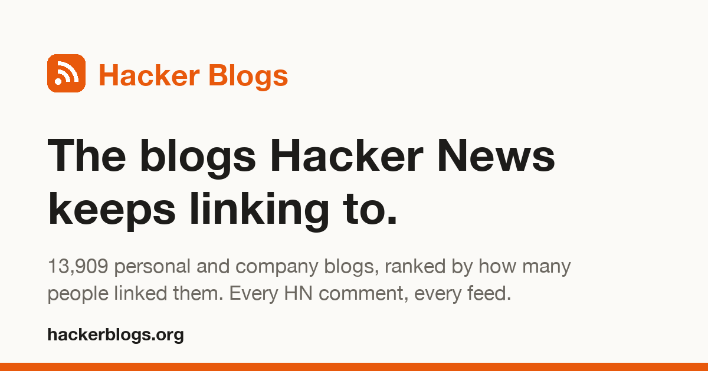
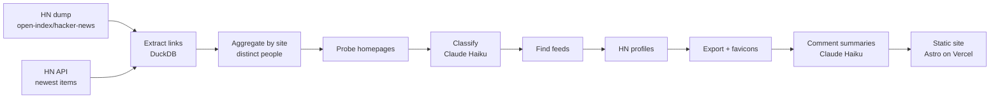

<p align="center">
  <a href="https://www.hackerblogs.org"></a>
</p>

<p align="center">
  <a href="https://www.hackerblogs.org"><strong>hackerblogs.org</strong></a> ·
  <a href="https://www.hackerblogs.org/top">Top all-time</a> ·
  <a href="https://www.hackerblogs.org/recommended">Most recommended</a> ·
  <a href="https://www.hackerblogs.org/rising">Rising</a> ·
  <a href="https://www.hackerblogs.org/about">About</a>
</p>

---

**Hacker Blogs** is a directory of the personal blogs, and the company blogs that write long form, that Hacker News keeps linking to. Every site that at least three different HN users linked in a story or comment is a candidate. Each listed blog comes with:

- **Every HN mention**: the stories and comments that linked it, with the thread they came from
- **What HN thinks of it**: a sample of comments judged as recommending, citing or criticising it
- **Its feed**: discovered and checked, with the date of the last post
- **Who writes it**: only what the owner publishes themselves (name, HN profile)
- **One-click follow**: pick blogs and follow them on [any-feeds](https://www.any-feeds.com), or export OPML for any reader

## How it works



| Step      | Where                    | What                                                                                                               |
| --------- | ------------------------ | ------------------------------------------------------------------------------------------------------------------ |
| `p00`     | Vercel Sandbox           | Download the monthly Parquet files of the HN dump                                                                  |
| `p01`     | Vercel Sandbox           | Fill the gap after the dump from the official HN API                                                               |
| `p02–04`  | Vercel Sandbox           | Extract every link from stories and comment HTML, count distinct people per site, keep sites with 3+               |
| `p05`     | Vercel Sandbox (sharded) | One GET per candidate homepage: title, description, feed hints                                                     |
| classify  | Laptop, `claude -p`      | Personal, company, publication, community, project or other, plus a homepage check for spam, parked and dead sites |
| `p06`     | Vercel Sandbox           | Feed discovery: `<link rel=alternate>`, body links, common paths, one HTML hop; parse and date the newest entry    |
| `p07–09`  | Vercel Sandbox           | Top HN profiles per blog, per-blog export, favicons                                                                |
| summarize | Laptop, `claude -p`      | Up to 40 sampled comments per blog judged as recommend / neutral / critical, with reasons that cite comment ids    |
| site      | Laptop → Vercel          | Static Astro build (~14k pages), deployed prebuilt                                                                 |

State lives on a Vercel Drive (`hackerblogs-data`) between Sandbox runs. All AI work runs through a local Claude Code subscription, isolated per call (no settings, tools or MCP servers).

## Stack

| Layer     | Tools                                                                                                       |
| --------- | ----------------------------------------------------------------------------------------------------------- |
| Pipeline  | Python 3.14, DuckDB, pyarrow, httpx (HTTP/1.1), selectolax, feedparser, Pillow                              |
| Compute   | [Vercel Sandbox](https://vercel.com/docs/vercel-sandbox) microVMs + a Vercel Drive, driven from `launcher/` |
| AI        | Claude Code (`claude -p`, Haiku) with JSON-schema output                                                    |
| Site      | [Astro](https://astro.build) static, Lucide icons as one SVG sprite, no client framework, own search        |
| Hosting   | Vercel (Build Output API, prebuilt deploys)                                                                 |
| Analytics | Self-hosted [Umami](https://umami.is), cookieless                                                           |

## Ranking rules

- **Listed:** personal blogs, and company blogs that publish long-form writing, with a working homepage and classifier confidence ≥ 0.7. Spam, parked domains and an [exclude list](pipeline/exclude.txt) are dropped; duplicate domains of one blog are merged.
- **Top all-time:** distinct people who linked the blog. **Rising:** distinct people in the last two years.
- **Most recommended:** Wilson lower bound (95%) of the recommend share, only from 30+ sampled comments, so a few glowing comments cannot top the list. Criticism shows only from 3+ critical comments. At most 3 comments per thread are sampled, and the author's own comments are left out.

## Repository

```
pipeline/   Python phases p00–p09, shared rules, exclude list
classify/   classification and comment summaries via claude -p
launcher/   @vercel/sandbox scripts: launch, status, shard, push, pull, export
site/       Astro site, data build scripts, OG image
docs/       README assets
```

## Running it

Needs Node 24, pnpm, Python 3.14, the Vercel CLI linked to the project, and Claude Code.

```bash
# pipeline in the Sandbox
cd launcher && pnpm install
vercel env pull .env.local          # OIDC token for the Sandbox SDK
pnpm launch                         # phases 00–05
pnpm status                         # follow the log; stops the sandbox when done
pnpm pull                           # Drive /data/out -> data/out

# classification on the laptop
python3 classify/classify.py data/out/to_classify.json data/out/classified.json --jobs 20
cd launcher && pnpm push-classified && pnpm launch --from 06 && pnpm pull

# comment summaries, then the site
python3 classify/summarize.py data/out/to_summarize.json data/out/summaries.json --jobs 4
python3 pipeline/merge_summaries.py data/out
cd site && pnpm install && pnpm data && pnpm build && pnpm vercel-output
vercel deploy --prebuilt            # from the repo root
```

A one-month smoke run: `pnpm launch --sample 2024-01`. Without a Sandbox: `HB_DATA=/some/dir pipeline/run_all.sh --sample 2014-01`.

Formatting and linting: `pnpm format` / `pnpm lint` at the root (Prettier for TypeScript and Astro, Ruff for Python).

## Crawler

`HackerBlogsBot/0.1 (+https://hackerblogs.org/about#crawler)`. One homepage request per candidate site, then feed discovery for listed blogs only: at most 2 requests in flight per host, 25 s per request, 1 MB per page (5 MB per feed), no JavaScript. Blog owners who want out can ask on [X](https://x.com/itsjulianpaul).

## Data and credits

Hacker News data from the [open-index/hacker-news](https://huggingface.co/datasets/open-index/hacker-news) dataset (ODC-BY) and the [Hacker News API](https://github.com/HackerNews/API). Not affiliated with Y Combinator or Hacker News. Inspired by Karpathy's HackerTube and HackerBooks.

Made by [Julian Paul](https://x.com/itsjulianpaul), built with Claude Code.
